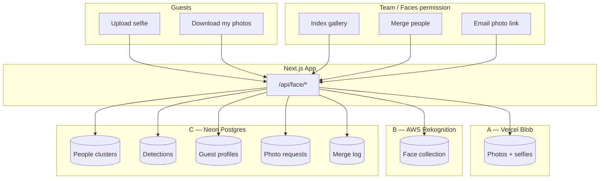
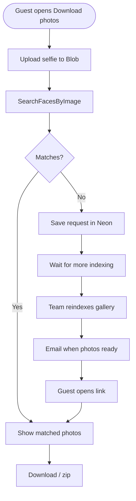
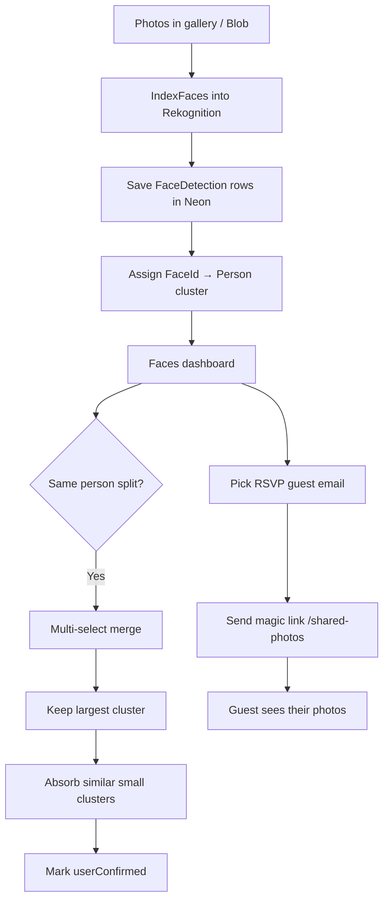

# #Swaneet — Wedding Invitation

A premium, cinematic wedding microsite for **Haneet Singh & Swarandeep Kaur**.

## Stack

- Next.js 15 · React · TypeScript · Tailwind CSS
- Framer Motion · GSAP · Lenis
- React Three Fiber · canvas-confetti
- Vercel Blob (images) · Neon Postgres (events / RSVPs / gallery metadata)
- AWS Rekognition (face find) · Firebase Auth · Resend (email)

## Getting started

```bash
npm install
npm run dev
```

Open [http://localhost:3000](http://localhost:3000).

Locally (without `DATABASE_URL`), invitation defaults come from `src/data/wedding.ts`.
With Neon connected, **all wedding content lives in Postgres** — not in a repo JSON file.

| Content | Storage |
| --- | --- |
| Events, gallery metadata, team, room pool | Neon `content_store` |
| RSVPs & stay requests | Neon `rsvps` / `accommodations` tables |
| Guest wishes | Neon `guest_messages` (via store) |
| Email status | Neon `email_logs` |
| Uploaded images/videos | Vercel Blob |

## Guest site map

Invitation homes stay **invitation-first** (hero, events, venue, gallery, family). Forms and hubs live on dedicated pages. Top ATL banners + nav deep-link there. Main and bride invites share the same guest surfaces; invite routes keep `InviteProvider` so flags / RSVP / stay resolve to **mehfil** or **laavan**.

| Surface | Main | Invite twin |
| --- | --- | --- |
| Home | `/` | `/i/[slug]` |
| RSVP | `/rsvp` | `/i/[slug]/rsvp` |
| Wishes wall + write | `/wishes` (`#write-wish`) | `/i/[slug]/wishes` |
| Photo upload | `/upload` | `/i/[slug]/upload` |
| Gallery | `/gallery` | `/i/[slug]/gallery` |
| My account | `/my-account` | `/i/[slug]/my-account` |
| Find my photos | `/my-photos` | `/i/[slug]/my-photos` |

Path helpers: `src/lib/guest-paths.ts` → `guestActionPath` / `wishesWritePath` / `absoluteGuestUrl`.

### Feature flags (per site)

Dashboard → Settings. Sites: `main` / `mehfil` / `laavan`.

| Flag | Default | Gates |
| --- | --- | --- |
| `rsvp` | on | RSVP page, nav, welcome |
| `accommodation` | on | Stay fields (+ with `stay_banner` → RSVP ATL) |
| `gallery` | on | Gallery viewing |
| `guest_photos` | on | Upload + Wish/Upload ATL photo half |
| `stay_banner` | on | RSVP/stay ATL |
| `face_find` | **off** | Find-photos ATL, nav, account tab, `/my-photos` |
| `guest_messages` | on | Wishes wall/write, Wish ATL, account wishes |
| `our_story` | **main on · invites off** | Our Story section + Story nav link |

### Top banners (ATL)

Shown under the hero on `/` and `/i/[slug]`:

| Banner | Flag | Links to |
| --- | --- | --- |
| Wish + Upload (`GuestEngageBanner`) | `guest_messages` / `guest_photos` | invite-aware `/wishes#write-wish`, `/upload` |
| Find my photos (`DownloadPhotosBanner`) | `face_find` | invite-aware `/my-photos` |
| Need Accommodation? / RSVP (`RsvpStayBanner`) | `stay_banner` + `accommodation` | invite-aware `/rsvp` |

RSVP banner image: Dashboard → Settings → site banner (`/api/site-banner`).

## Guest wishes

| Piece | Detail |
| --- | --- |
| Auth | **Google only** — name + email from the signed-in account (`src/lib/guest-wish-identity.ts`). No manual name/email fields. |
| Limits | Up to **10** wishes per Google account |
| Lifecycle | Submit → `pending` → family approve / reject. Guest edit returns to pending. |
| Public wall | Anyone can read `/wishes` (+ invite twin). Write requires Google. |
| Hero | Soft blurred wish backdrop + rotating blessing that links to the wall |
| Flag | `guest_messages` |
| APIs | `GET/POST /api/messages`; guest `PATCH/DELETE /api/messages/[id]` |

UI: `src/components/sections/GuestWishes.tsx`. Account manage: My account → **Your wishes**.

### Wish status emails

Guests get Resend mail automatically (logged in `email_logs`):

| Kind | When |
| --- | --- |
| `wish_received` | Submit or guest edit (in review) |
| `wish_live` | Approved |
| `wish_note` | Rejected |

Helpers: `sendGuestWishReceivedEmail` / `sendGuestWishLiveEmail` / `sendGuestWishNoteEmail` in `src/lib/email.ts`.

Wish email “view wall” links use `/i/{inviteSlug}/wishes` when the wish was posted from an invite; otherwise `/wishes`.

Dashboard can **Resend** status emails, or **Save email & send** when a wish has no address on file (`POST /api/messages/moderate` action `notify`).

## RSVP

| Behavior | Detail |
| --- | --- |
| Pages | `/rsvp` (+ invite twin) — not embedded on invitation home |
| Auth | Google; signed-in guests skip “please sign in” copy |
| Existing reply | Loads via `/api/rsvp/me` — shows **thanks** on refresh (not a blank form) |
| Edit | “Edit your reply” on the RSVP page; also under **My account → RSVP** |
| Stay | Optional accommodation when `accommodation` is on |

UI: `src/components/sections/RSVP.tsx`.

## My account

Guest hub at `/my-account` and `/i/[slug]/my-account` (`GuestAccountPanel` · `GET /api/account?site=…`). Invite twin keeps mehfil/laavan RSVP + flags.

| Tab | What guests can do |
| --- | --- |
| Stay booking | View stay / offer status |
| RSVP | View + edit attendance |
| Your uploads | Guest photo status (pending / approved / rejected) |
| Your wishes | List, add (under limit), edit, remove |
| Find my photos | When `face_find` is on for that site |
| Ask a question | Message the family |

## Dashboard

Manage the wedding at `/dashboard`.

Default PIN: `swaneet10`  
Override with `ADMIN_PIN` in `.env.local`.

| Area | Notes |
| --- | --- |
| People → RSVPs / Stays | Attendance + accommodation |
| People → Wishes | Approve / reject / delete; resend emails; attach missing email (`GuestWishesReview`, permission `messages`) |
| Gallery / Faces | Photos + face find |
| Events / Team / Settings | Content, roles, feature flags, site banner |

## Deploy on Vercel

1. Push this repo to GitHub (already at `HaneetGH/Swaneet-`).
2. Import the project in [Vercel](https://vercel.com/new).
3. **Required for dashboard edits:** In the Vercel project → **Storage**, connect:
   - **Neon / Postgres** → sets `DATABASE_URL` / `POSTGRES_URL` (events, RSVPs, gallery metadata)
   - **Blob** → sets `BLOB_READ_WRITE_TOKEN` (**required for photos/videos** — uploads go direct to Blob, bypassing the 4.5MB serverless limit)
4. Set environment variables:
   - `ADMIN_PIN` = your private dashboard PIN
   - Firebase web config (`NEXT_PUBLIC_FIREBASE_*`) + `FIREBASE_PROJECT_ID` for accommodation login
5. In Firebase Console → Authentication, enable **Google**.
6. Add your Vercel domain under Authentication → Settings → Authorized domains.
7. Redeploy after connecting storage / Firebase.
8. Email (stay confirms, team invites, photo OTP, **wish status**): set `RESEND_API_KEY` (Resend domain `mail.technorapper.com` → From `noreply@mail.technorapper.com`). Optional override: `EMAIL_FROM="Swaneet Wedding <noreply@mail.technorapper.com>"`.

Wedding data (events, RSVPs, gallery, stays, wishes) lives in **Neon Postgres** — **deploys never wipe it**. Seed defaults only run when the database is empty.

Without `DATABASE_URL` on Vercel, the dashboard cannot save.

On Vercel, the app automatically uses:

- **Neon Postgres** for events, RSVPs, stays, gallery metadata, team, PIN
- **Vercel Blob** for uploaded images/videos
- Invitation defaults from `src/data/wedding.ts` only to seed an empty database

No `data/content.json` in production — that file is local-dev only and ignored by git.

### Env vars

Copy `.env.example` to `.env.local` for local cloud testing:

```bash
ADMIN_PIN=swaneet10
DATABASE_URL=postgresql://...
BLOB_READ_WRITE_TOKEN=vercel_blob_...
RESEND_API_KEY=re_...
EMAIL_FROM="Swaneet Wedding <noreply@mail.technorapper.com>"
```

## Customize

| Content | File |
| --- | --- |
| Names, venue, family, RSVP defaults | `src/data/wedding.ts` |
| Theme colors | `src/app/globals.css` |
| Invitation art | `public/images/invitation.png` |
| Background music (optional) | `public/audio/wedding-ambient.mp3` |

Music is muted by default. Add an MP3 at the path above to enable the toggle.

## Face recognition (Find my photos)

Guests can find wedding photos of themselves with a selfie. Team members with the **Faces** permission manage people clusters and can email photo links to RSVP guests.

### Simple model (A / B / C)

| Piece | Service | Role |
| --- | --- | --- |
| **A — Files** | Vercel Blob | Stores photo + selfie bytes (URLs) |
| **B — Brain** | AWS Rekognition | Detects faces, compares similarity (`IndexFaces` / `SearchFaces` / `SearchFacesByImage`) |
| **C — Memory** | Neon Postgres | People clusters, detections, guest profiles, merge history, photo-request queue |
| **App** | Next.js APIs | Glue: upload → index → assign → merge → email links |

Rekognition does **not** store your wedding album. Neon does **not** run face matching. The app connects them.

### High-level architecture



### Guest flow — find & download photos



### Team flow — index, merge, share



### What learns vs what does not

| Action | What changes |
| --- | --- |
| Index gallery | New FaceIds in Rekognition + detections in Neon |
| Merge people | Neon Person buckets + optional reinforce via SearchFaces |
| Guest selfie | Temporary search only (not stored as training by default) |
| Model weights | **Never** — AWS Rekognition model is not retrained by this app |

### Env vars (face find)

| Variable | Purpose |
| --- | --- |
| `AWS_ACCESS_KEY_ID` / `AWS_SECRET_ACCESS_KEY` | Rekognition credentials |
| `AWS_REGION` | e.g. `ap-south-1` (trim spaces) |
| `AWS_REKOGNITION_COLLECTION_ID` | Face collection name |
| Feature flag `face_find` | Per-site toggle (main / mehfil / laavan) |
| Team permission `faces` | Who can index / merge / email links |

Guest UI: homepage **Download your photos** banner → `/my-photos`.  
Admin UI: Dashboard → **Faces**. Shared links: `/shared-photos?t=…`.

## Scripts

- `npm run dev` — development server
- `npm run build` — production build
- `npm run start` — start production server
- `npm run lint` — ESLint
